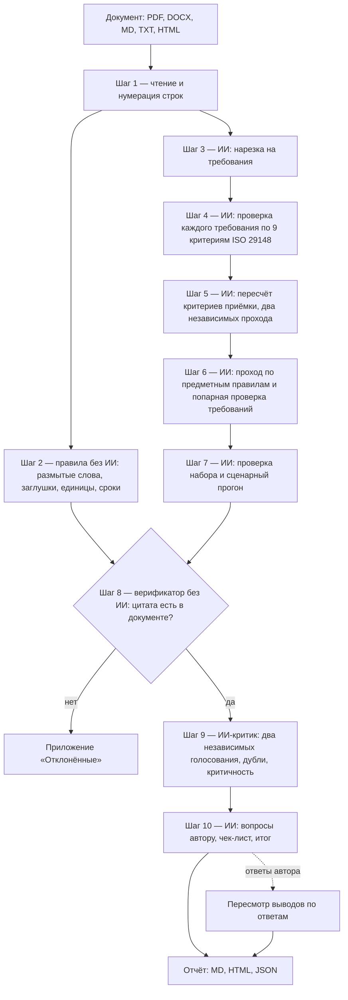

# ТЗ-Аудитор

ИИ-агент, который проверяет документ с требованиями (ТЗ) до начала разработки — как аудитор проверяет отчётность: по стандарту, с доказательствами и заключением.

Агент читает документ, выделяет отдельные требования, проверяет каждое и весь набор по критериям ISO/IEC/IEEE 29148:2018 (п. 5.2.5, 5.2.6) и IEEE Std 830-1998 (п. 4.3), задаёт уточняющие вопросы автору и пишет отчёт на русском языке.

Решение для **BCC-HUB × MNU FinTech Hackathon 2026**, кейс «Агент проверки требований».

---

## Быстрый старт

Нужен Python 3.10 или новее.

**1. Скачать проект и установить зависимости**

```bash
git clone https://github.com/zhumakhemtovulan-lgtm/tz-auditor.git
cd tz-auditor
python -m venv .venv
# Windows:
.venv\Scripts\activate
# macOS / Linux:
source .venv/bin/activate
pip install -r requirements.txt
```

**2. Получить бесплатный ключ Gemini**

1. Откройте [aistudio.google.com/apikey](https://aistudio.google.com/apikey) и войдите через Google-аккаунт.
2. Нажмите **Create API key** и скопируйте ключ.

**3. Положить ключ в файл `.env`**

```bash
# Windows:
copy .env.example .env
# macOS / Linux:
cp .env.example .env
```

Откройте `.env` и замените `your_gemini_api_key_here` на свой ключ. Файл `.env` уже в `.gitignore` и в репозиторий не попадёт.

**4. Запустить проверку одной командой**

```bash
python -m tz_auditor docs/requirements.md reports/report.md
```

Первый аргумент — путь к документу с требованиями (PDF, DOCX, MD, TXT, HTML), второй — путь к отчёту.

**5. Где отчёт**

| Файл | Что это |
| :--- | :--- |
| `reports/report.md` | Основной отчёт (Markdown, читается на GitHub) |
| `reports/report.html` | Тот же отчёт для браузера; печать → «Сохранить как PDF» |
| `reports/report.json` | Все данные прогона для других систем (Jira, BI) |
| `reports/report.answers.yaml` | Шаблон для ответов на уточняющие вопросы |
| `reports/report.log` | Журнал прогона: шаги, время, обращения к модели |

Прогон занимает 2–5 минут на бесплатном тарифе (агент делает паузы между запросами, чтобы не упереться в лимит).

**Модель по умолчанию:** `gemini-3.8-flash` (бесплатный тариф Google AI Studio). Другую модель можно указать в `.env` (`GEMINI_MODEL=...`) или флагом `--model`. Если модель перегружена (ошибка 503) или недоступна (404), агент сам переключается на резервную из `GEMINI_FALLBACK_MODELS` и пишет это в паспорт отчёта. Какие модели отвечают прямо сейчас, покажет команда `python -m tz_auditor.check`.

---

## Уточняющие вопросы: диалог с автором ТЗ

Агент не только находит дефекты, но и формулирует вопросы к автору документа: с вариантами ответа, приоритетом и адресатом. Ответы можно дать двумя способами, и агент пересмотрит выводы: какие замечания закрыты, как переписать требование.

```bash
# В консоли: агент задаёт вопросы по одному
python -m tz_auditor docs/requirements.md reports/report.md --interactive

# Из файла: впишите ответы в reports/report.answers.yaml и запустите
python -m tz_auditor docs/requirements.md reports/report_v2.md --answers reports/report.answers.yaml
```

Повторный запуск почти бесплатный: уже полученные ответы модели берутся из кэша `.cache/llm`, новый запрос только один — пересмотр по ответам.

---

## Как устроен агент



**Почему отчёту можно доверять**

- **Доказательства проверяет код, а не модель.** Каждое замечание обязано содержать дословную цитату. Модуль `verify.py` ищет её в документе и определяет номера строк. Замечание без подтверждённой цитаты в отчёт не попадает. Это прямо закрывает требование «каждое нарушение ссылается на конкретное место».
- **Второй аудитор с голосованием.** Критик проверяет замечания дважды независимо. Замечание считается ложным, только если оба прохода с этим согласны. Отклонённые замечания видны в приложении, ничего не скрывается.
- **Защищённые доказательства.** Замечания, подтверждённые правилом без ИИ или пересчётом критерия приёмки, критик не может удалить — только отметить дубль. Если два пересчёта показали, что критерий приёмки верен, замечание «критерий противоречит требованиям» снимается кодом.
- **Повторное выполнение критериев приёмки.** Каждый критерий «исполняется» по правилам документа шаг за шагом (как пересчёт в аудите), результат сравнивается с ожидаемым. Так находятся противоречия между требованием и примером.
- **Попарная проверка.** Для каждой пары функциональных требований агент строит ситуацию, где действуют оба, и сравнивает результаты.
- **Гибрид: правила + ИИ.** Шаблонные проверки (`rules.py`) работают без модели и дают одинаковый результат при каждом запуске.
- **Сценарный прогон.** Агент прогоняет пограничные сценарии (граница порога, смена месяца, возврат, повтор события, смена настройки) через правила документа; конфликт или пробел становится замечанием.
- **Итоговое решение по правилу.** «Можно ли начинать разработку» определяется по шкале критичности (`methodology/severity.md`), а не по настроению модели — как аудиторское заключение: без оговорок / с оговоркой / отрицательное.

**Методика — отдельно от кода.** Всё, что агент знает о качестве требований, лежит в папке `methodology/` обычным текстом. Чтобы изменить «мозг» агента, достаточно отредактировать эти файлы:

| Файл | Что внутри |
| :--- | :--- |
| `criteria.md` | Критерии ISO/IEC/IEEE 29148 и IEEE 830 с пояснениями, как проверять |
| `domain_rules.md` | Предметные правила финтеха и учёта: единицы, отсечение периода, возвраты, дубли, API |
| `questions.md` | Как формулировать уточняющие вопросы |
| `severity.md` | Шкала критичности и правило итогового решения |
| `checklist.md` | Чек-лист ревью по умолчанию (если в документе нет своего) |

**Устойчивость к плохим файлам.** Агент не падает, а объясняет, что не так: файл не найден, пустой, двоичный, повреждённый или обрезанный PDF, PDF-скан без текста, PDF с паролем, битый DOCX, старый `.doc`, кодировка не UTF-8 (определяется автоматически). Если упал второстепенный шаг (критик, вопросы), отчёт всё равно формируется с пометкой в паспорте.

**Бережёт лимиты.** Около 12–15 обращений к модели на документ, паузы между запросами, повторы при ошибках сети и лимитах, кэш ответов: при сбое повторный запуск продолжает с места остановки.

---

## Другие модели и работа без интернета

Банку часто нельзя отправлять внутренние документы во внешний сервис. Агент работает и с локальной моделью через [Ollama](https://ollama.com): документ не покидает компьютер.

```bash
ollama pull qwen2.5:14b
# в .env: LLM_PROVIDER=ollama и OLLAMA_MODEL=qwen2.5:14b
python -m tz_auditor docs/requirements.md reports/report_local.md
```

Также поддерживаются OpenAI и любые OpenAI-совместимые сервисы (`LLM_PROVIDER=openai`, `OPENAI_BASE_URL`).

---

## Состав отчёта

0. **Резюме для руководителя:** вердикт, главные дефекты с номерами строк, главные вопросы — на одном экране.
1. **Паспорт прогона:** документ, контрольная сумма файла, дата, модель, версия агента (коммит git), длительность, число обращений к модели и токены.
2. **Как агент нарезал требования:** таблица «ID в отчёте — ID в документе — тип — где — формулировка — цитата».
3. **Проверка каждого требования:** матрица по 9 критериям ISO 29148 и подробные замечания с цитатами, риском, рекомендацией и предлагаемой формулировкой.
4. **Проверка всего набора:** 8 свойств набора, пересчёт критериев приёмки, проход по предметным правилам, сценарный прогон, замечания уровня набора.
5. **Уточняющие вопросы** к автору ТЗ с вариантами ответов и приоритетом.
6. **Чек-лист ревью** документа, заполненный агентом.
7. **Сводка:** число требований и нарушений, список критичных и существенных дефектов по типам.
8. **Итог:** можно ли начинать разработку и тестирование и что исправить в первую очередь.
9. Приложения: автоматические проверки без ИИ и отклонённые замечания.

---

## Проверка качества самого агента

```bash
python -m pytest -q                                   # тесты без обращения к модели
python eval/eval.py reports/report.json eval/gold.yaml # сравнение с ручным ревью команды
```

`eval/gold.yaml` — ручное эталонное ревью команды (формат в `eval/gold.example.yaml`). Агент этот файл не читает: он нужен только для измерения полноты.

---

## Структура проекта

```
tz_auditor/
  cli.py        запуск из командной строки
  loader.py     чтение PDF / DOCX / MD / TXT / HTML, обработка плохих файлов
  rules.py      автоматические правила без ИИ
  prompts.py    инструкции модели по шагам (подставляют methodology/)
  llm.py        обращение к модели: Gemini, OpenAI, Ollama; повторы, кэш
  pipeline.py   конвейер проверки
  verify.py     верификатор цитат
  report.py     отчёт MD / HTML / JSON
  schemas.py    структуры данных
methodology/    методика проверки (редактируется без программирования)
docs/           проверяемый документ
reports/        отчёты прогонов
eval/           оценка качества агента
tests/          тесты и тестовые файлы, включая повреждённые
```

## Ограничения

- Сканы PDF без текстового слоя нужно предварительно распознать (OCR).
- Качество находок зависит от модели. Более сильная модель находит больше тонких противоречий.
- Агент оценивает текст документа и не знает внутренних систем банка: такие вопросы он формулирует как уточняющие.
